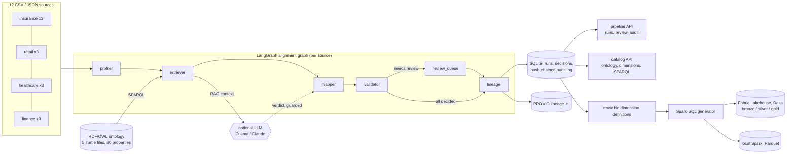

# OntoBridge

[](https://github.com/Manvith-d/ontobridge/actions/workflows/ci.yml)

**Agentic semantic data platform.** LangGraph agents align messy CSV/JSON extracts with RDF/OWL ontologies,
send uncertain mappings to a human, record every decision as PROV-O lineage, and generate Microsoft Fabric
Lakehouse star schemas (Spark SQL) from the result.

```
12 synthetic sources (4 domains)  ->  LangGraph alignment agents  ->  reviewed mappings  ->  Spark SQL star schemas
policy_admin.csv, claims_events.json   SPARQL retrieval + RAG        audit log + PROV-O     bronze / silver / gold
```

Everything runs locally and for free. The LLM is optional (`ONTOBRIDGE_LLM=none` by default; a local Ollama
model works), and the deterministic path is what the tests and numbers below measure.

## Results

Measured by `ontobridge eval` against a hand-written gold key. CI fails if any wrong mapping is auto-accepted.

| Split | Columns | Auto-accepted | Precision of accepts | Sent to review | Abstained | Top-1 | Wrong and unflagged |
|---|---:|---:|---:|---:|---:|---:|---:|
| Tuning (original column names) | 105 | 101 | 100% | 0 | 4 (all correct) | 100% | 0 |
| **Held-out (54 renamed columns)** | 54 | 43 | **100%** | 3 | 8 | 87.0% | **0** |

The ontology's synonyms were written next to the synthetic data, so the tuning split is optimistic by
construction. The held-out split renames 54 columns to names chosen after the ontology was frozen
(`coverage_start`, `indemnity_paid`, `physician_full_name`, `mgr_name` ...) and is the honest number. Its 7
misses are all visible: 2 reach the review queue with a wrong suggestion and 5 abstain (e.g. `adm_dt`,
`appointed_on`). None is silently wrong. That is the design goal: an agent that knows when to ask.

The generated star schemas run on Spark: **30 gold tables across 4 domains, 65 validation checks** (fact row
counts match their source, no orphan foreign keys, unique surrogate keys), all passing in CI.

## Architecture



## How it works

### 1. Ontologies (`ontology/*.ttl`)
Five OWL ontologies (core, insurance, retail, healthcare, finance) with 80 datatype properties and 236 SKOS
synonyms. Each property declares its role with the W3C Data Cube vocabulary (`qb:MeasureProperty`,
`qb:DimensionProperty`, `qb:AttributeProperty`, or `ob:IdentifierProperty`), its XSD range, an optional value
pattern, and the conformed dimension it belongs to (`ob:conformedDimension ob:CustomerDimension`, with
`ob:naturalKey true` on the business key). The star schemas are derived from these declarations, not from
per-source code.

### 2. Alignment agents (`src/ontobridge/agents.py`)
A LangGraph `StateGraph` runs once per source:

| Node | Job |
|---|---|
| `profiler` | infers each column's XSD type, null rate, distinctness and sample values |
| `retriever` | SPARQL keyword search over labels and synonyms, then scores candidates: `0.62 lexical + 0.16 type + 0.10 value pattern + 0.12 domain` |
| `mapper` | accepts at >= 0.80 with a 0.03 lead over the runner-up, reviews between 0.55 and 0.80, abstains below. Optionally asks an LLM about uncertain columns |
| `validator` | ontology consistency: one column per property per source, range compatibility. Conflicts go to review |
| `review_queue` | conditional: runs only when something needs a human, and says why |
| `lineage` | writes each decision as PROV-O (`prov:wasDerivedFrom`, `prov:wasAttributedTo`, `ob:alignedTo`) |

Every output is a typed `MappingDecision` (Pydantic) carrying the chosen property, status, score breakdown,
candidates and a reason, so tests assert on agent outputs directly.

### 3. SPARQL retrieval and RAG (`ontology.py`, `retrieval.py`, `llm.py`)
Candidates come from a SPARQL query over `rdfs:label` and `skos:altLabel`. A second query builds the grounding
context for each candidate: its comment, range, role, conformed dimension and that dimension's other members.
That context goes into the LLM prompt, along with the column profile and heuristic scores. Guardrails:
- the model can only choose a retrieved candidate, or "none"
- the reply must be JSON
- it can auto-accept only when it is confident (>= 0.80) **and** the candidate cleared the abstain threshold on its own evidence; otherwise its answer is a suggestion for the reviewer
- anything malformed or unreachable falls back to the heuristic

The same SPARQL context grounds the reusable dimension definitions.

### 4. Reusable dimensions and star schemas (`dimensions.py`, `starschema.py`)
`define_dimensions` turns the ontology plus the accepted mappings into 14 conformed dimension definitions:
the natural key, the attributes some source carries, the contributing sources, and a description written
from the ontology (or by the LLM, with citations required). `dim_customer` is defined once and built in
insurance, retail and finance.

`ontobridge model` generates one Spark SQL script per domain ([`fabric/`](fabric)):
- **bronze**: raw files loaded as tables
- **silver**: columns renamed to ontology terms and cast to their XSD types (``CAST(`PREM_AMT` AS DECIMAL(18,2)) AS premium_amount``)
- **gold**: conformed dimensions with `xxhash64` surrogate keys and an UNKNOWN (-1) member, a composite-key `dim_location`, a generated `dim_date`, and one fact per source that carries measures. Attributes move to their dimension; identifiers without a dimension stay as degenerate dimensions

| Domain | Facts | Dimensions |
|---|---|---|
| insurance | `fact_policy_admin`, `fact_claims_events` | customer, policy, agent, location, date |
| retail | `fact_pos_sales`, `fact_ecommerce_orders` | customer, product, store, location, date |
| healthcare | `fact_ehr_encounters`, `fact_pharmacy_fills` | patient, provider, facility, location, date |
| finance | `fact_ledger_entries`, `fact_card_transactions` | customer, account, currency, merchant, branch, location, date |

It also writes a Fabric notebook (`%%sql` cells plus a validation cell per domain), the dimension
definitions as JSON, and `lineage.ttl`: gold column -> source column in PROV-O, plus a `qb:DataStructureDefinition`
per fact. `--target fabric` emits Delta tables reading `Files/raw/...`. `--target local --execute` runs the
same SQL on local Spark with Parquet and executes the validation checks.

### 5. Services, review, audit and provenance (`services/`, `store.py`)
Two FastAPI microservices share one store.

**pipeline** (`:8000`)

| Endpoint | |
|---|---|
| `POST /runs` | run the alignment graph over all or some sources |
| `GET /runs/{id}/decisions?status=` | agent outputs with evidence |
| `GET /review` | the review queue |
| `POST /decisions/{id}/review` | approve, reject or override (with reviewer and note) |
| `POST /runs/{id}/model` | generate the star schema SQL for review, without executing it |
| `GET /runs/{id}/lineage` | PROV-O Turtle as the run stands now, reviews included |
| `GET /audit`, `GET /audit/verify` | the audit log and a full chain verification |

**catalog** (`:8001`)

| Endpoint | |
|---|---|
| `GET /properties`, `GET /properties/{name}` | the ontology, with SPARQL-built context |
| `GET /dimensions` | reusable dimension definitions for the latest run |
| `POST /retrieve` | what the retriever sees for any column name and sample values |
| `POST /sparql` | read-only SELECT and ASK; updates are rejected |

Each audit entry stores the SHA-256 of its content and the previous entry's hash. Editing or deleting any
past entry breaks the chain, and `/audit/verify` (or `ontobridge audit --verify`) reports the first broken
sequence number. Review actions record the before and after state, so every mapping in a generated table
can be traced to the agent or person who decided it.

## Quickstart

```bash
uv venv && uv pip install -e ".[dev,spark]"   # Spark needs Java 17+
ontobridge align                              # run the agents over the 12 sources
ontobridge eval                               # tuning and held-out metrics
ontobridge model --target local --execute     # generate SQL, run it on Spark, validate it
ontobridge model --target fabric              # regenerate fabric/*.sql and the notebook
ontobridge audit --verify
ontobridge serve pipeline --port 8000         # or: docker compose up
pytest -q                                     # 18 tests, including the Spark run
```

To use an LLM:

```bash
uv pip install -e ".[ollama]"
ONTOBRIDGE_LLM=ollama:llama3.1 ontobridge eval
```

`anthropic:<model>` also works with `ANTHROPIC_API_KEY` set.

To run on Fabric:
1. Upload `data/sources/` to the lakehouse as `Files/raw/`.
2. Import `fabric/ontobridge_lakehouse.ipynb` into a schema-enabled lakehouse.
3. Run all cells.

## Layout

```
ontology/            5 OWL ontologies (Turtle)
data/sources/        12 synthetic extracts; regenerate with scripts/generate_data.py (seeded)
data/gold/           gold mapping key and the held-out renames
src/ontobridge/      agents, retrieval, scoring, llm, dimensions, starschema, lineage, store, eval, cli
src/ontobridge/services/   pipeline_api.py, catalog_api.py
fabric/              generated Spark SQL, Fabric notebook, dimension definitions, lineage
tests/               alignment quality, LLM guardrails, audit tampering, APIs, Spark execution
```

## Limitations

- **The data is synthetic.** The sources are 200-row extracts. Real ones have messier values, unit and encoding problems, and more columns than an 80-property ontology covers.
- **The tuning numbers are optimistic** for the reason above. Use the held-out row. A real deployment would need a larger, independently labeled evaluation set.
- **The LLM path is tested with a fake chat model** (guardrails, promotion rules, fallbacks), not benchmarked against a real model. No LLM numbers are claimed.
- **The Fabric target is generated and syntax-compatible** with Fabric Spark SQL, but CI executes the local Parquet variant. Running it on Fabric is the manual step above.
- **Dimensions keep one value per key** (`max()`) when sources disagree. Survivorship rules and SCD Type 2 history are not implemented.
- **SQLite and a single lock** are enough for one pipeline. A shared deployment would want Postgres and authentication on the review endpoints.

## License

MIT
